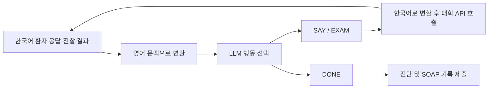
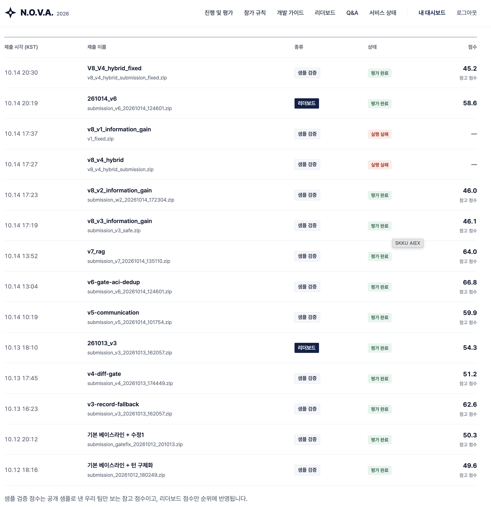

<div align="center">

# N.O.V.A. · Doctor Agent

### 한국어 진료 대화를 위한 LLM 기반 에이전트

**Python · LLM Agents · Prompt Engineering · Clinical Simulation**

N.O.V.A. 2026 대회에서 팀원들과 함께 개발한 모의 진료 에이전트입니다.

**최종 성적·순위는 아직 발표 전이며, 발표 후 업데이트할 예정입니다.**

</div>

## 프로젝트 소개

환자와 한국어로 대화하며 필요한 정보를 수집하고, 신체 진찰을 요청한 뒤 진단과 SOAP 형식의 진료 기록을 제출하는 에이전트입니다. 팀원들과 프롬프트를 공동 설계·개선하며 질문의 우선순위, 반복 질문 방지, 제한된 상호작용 횟수 안에서의 정보 수집을 다뤘습니다.

이 저장소가 프로젝트의 **주 저장소**입니다. 기존 `nova-medical-ai`에 있던 소개를 실제 구현과 함께 이곳에 통합했습니다.

## 구현과 현재 상태

| 구성 | 내용 | 상태 |
| --- | --- | --- |
| 진료 에이전트 | SAY / EXAM / DONE 행동 선택, 진단 및 진료 기록 제출 | `agent/run.py` v32 구현 |
| 한영 처리 | 한국어 관찰을 영어 문맥으로 변환하고, 선택한 행동을 한국어로 전달 | 구현 |
| 프롬프트 | 정보 수집 우선순위, 중복 질문 방지, 행동 형식·글자 수·턴 예산 관리 | 구현 |
| 샘플 검증 | 공개 샘플 목록, 개별 및 전체 케이스 실행 | 대회 API 접근 권한 필요 |
| 검색 도구 | 진료지침 청크 생성, BM25 검색, SOAP 인덱스 및 평가 도구 | 별도 도구 포함 |
| 에이전트 RAG 통합 | `RagStore` 연결부 | **현재 v32에서는 비활성화 / 미구현** |

검색용 도구가 포함되어 있다는 것이 현재 에이전트가 검색 결과를 사용한다는 뜻은 아닙니다. `agent/run.py`의 `RagStore.load()`와 `retrieve()`는 현재 연결 지점만 남아 있습니다.

## 동작 흐름



## 실행

Python 3.10 이상이 필요합니다. 에이전트와 SDK는 Python 표준 라이브러리를 사용합니다. 실행에는 대회에서 발급한 API 주소·개발 키와 유효한 샘플 접근 권한이 필요하며, 이 저장소만으로 대회 서버를 실행할 수는 없습니다.

```bash
git clone https://github.com/jaehyeongahn01/nova.git
cd nova
python3 -m venv .venv
source .venv/bin/activate

# 대회에서 발급받은 값으로 설정하세요. 키를 소스나 Git에 저장하지 마세요.
export NOVA_API_BASE="https://YOUR-COMPETITION-API"
export NOVA_DEV_KEY="YOUR-DEVELOPMENT-KEY"

python agent/sample.py --list
python agent/sample.py --case YOUR_PUBLISHED_CASE_ID
# 공개 샘플 전체 실행
python agent/run_all_cases.py
```

대회 API 호출은 인증된 계정의 실행 한도·정책을 따릅니다. `run_all_cases.py`의 결과 로그는 기본적으로 Git에서 제외됩니다.

## 검색 도구

`index-tools/`에는 진료지침을 임상 섹션으로 나누고 BM25 검색 인덱스 등을 만드는 코드가 있습니다. 사용 권한이 있는 원문을 `guidelines/`에 준비한 뒤 다음 순서로 기본 인덱스를 생성합니다.

```bash
python index-tools/build_chunks.py
python index-tools/build_bm25.py
python index-tools/retriever.py "right lower quadrant pain"
```

원문 코퍼스·생성 인덱스는 재배포 제한과 용량 때문에 포함하지 않았습니다. 위 과정은 **별도 검색 도구 실행**이며 에이전트의 RAG를 자동 활성화하지 않습니다. Pickle 인덱스는 신뢰하는 로컬 자료로 생성한 것만 사용하세요.

## 개발 기록 및 결과

**최종 성적·순위·수상 결과: 발표 후 업데이트 예정.**

<details>
<summary>개발 중 제출 이력 보기 — 최종 결과 아님</summary>



위 화면은 개발 중 샘플 검증 및 중간 제출 기록입니다. 화면 속 수치는 최종 v32의 공식 성적이나 최종 순위를 의미하지 않습니다.

</details>

## 저장소 구조

```text
agent/        v32 에이전트, 대회 SDK, 샘플 실행 도구
index-tools/  청크 생성, BM25·SOAP 인덱스, 검색 및 평가 코드
docs/         초기 개발 기획안 및 중간 제출 이력
```

`docs/`의 기획안에는 초기 설계와 향후 계획이 포함됩니다. 현재 구현 여부는 위 상태 표와 소스 코드를 기준으로 확인해 주세요. 대회용 모의 진료 프로젝트이며 실제 환자 진단이나 치료에 사용하기 위한 시스템이 아닙니다.
